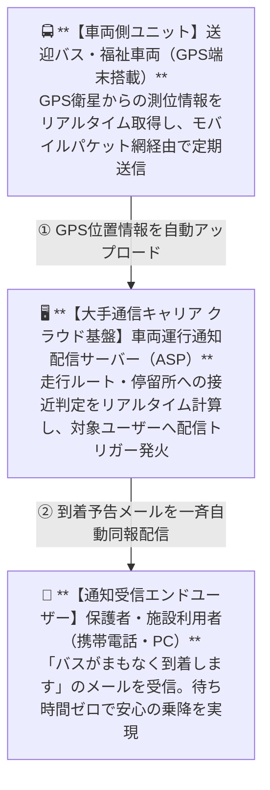
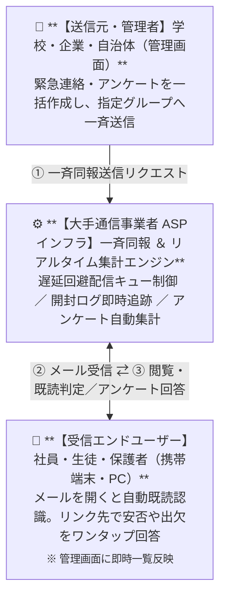
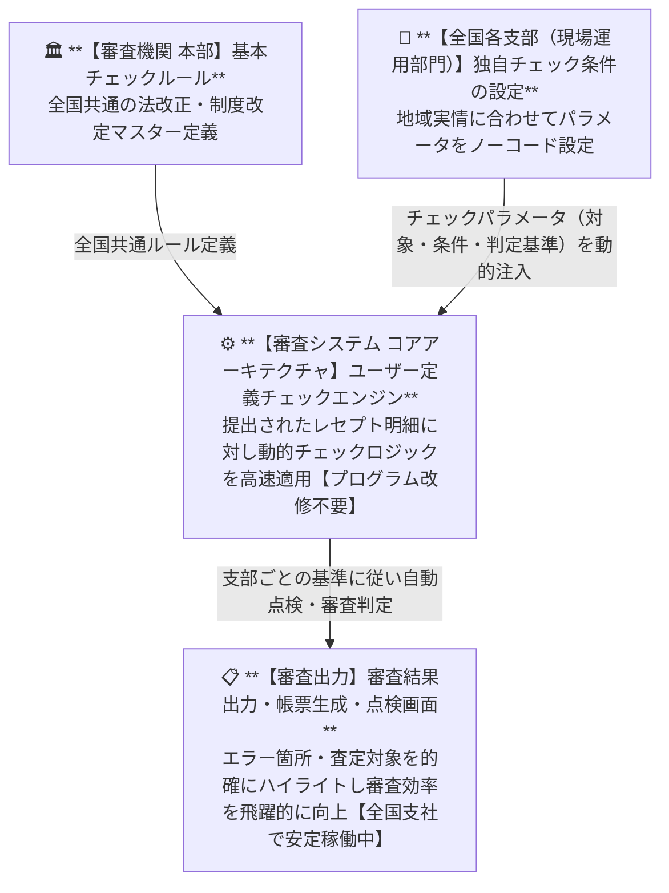
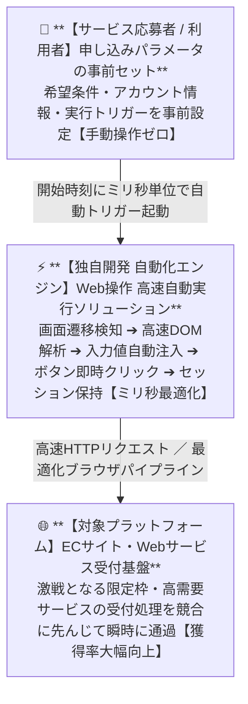

# 新サービス企画・システム開発 実績ポートフォリオ
### Track Record of Innovation & Implementation

> [!NOTE]
> ※ 守秘義務に配慮し、顧客名・関係先等の固有名詞は秘匿表記としております。

大手通信キャリアの公式ASPサービス化から全国規模の公的審査基盤、EC・Web高速自動化基盤まで。  
クライアントや現場の潜在的課題を的確に捉え、独自のアイデアと高信頼なアーキテクチャ設計によって社会実装・事業化を実現した主要プロジェクト実績のまとめです。

---

## 目次 (Table of Contents)

1. [主要プロジェクト一覧 & タイムライン](#1-主要プロジェクト一覧--タイムライン)
2. [コア・コンピテンシー（強み・専門性）](#2-コアコンピテンシー強み専門性)
3. [プロジェクト詳細](#3-プロジェクト詳細)
   - [CASE 01: バスロケーション・車両運行通知サービス](#case-01-バスロケーション車両運行通知サービス)
   - [CASE 02: メール一斉同報・開封確認／安否確認システム](#case-02-メール一斉同報開封確認安否確認システム)
   - [CASE 03: レセプト審査システム「ユーザー定義チェックエンジン」](#case-03-レセプト審査システムユーザー定義チェックエンジン)
   - [CASE 04: Webサービス申し込み操作 高速自動化ソリューション](#case-04-webサービス申し込み操作-高速自動化ソリューション)
4. [価値提供アプローチ & 実績の軌跡](#4-価値提供アプローチ--実績の軌跡)

---

## 1. 主要プロジェクト一覧 & タイムライン

20年以上にわたり、ビジネス課題の特定からアーキテクチャ設計、システム実装までを一気通貫で推進してきました。

| 時代・プロジェクト | クライアント / 対象領域 | 提起された課題・市場背景 | 考案したアイデア・企画システム | 成果・ビジネスインパクト |
| :--- | :--- | :--- | :--- | :--- |
| **2000年代前半**<br>① **バスロケーション通知サービス** | **大手携帯通信キャリア A社**<br><sub>（送迎バス・福祉車両・一般利用者）</sub> | ・若年女性層の携帯シェア引き上げ<br>・生活密着型キラーサービスの創出ニーズ | 送迎バスにGPS端末を搭載。バス接近時に保護者・利用者の携帯/PCへメールで一斉自動通知する仕組みを企画・開発。 | **キャリア公式ASPサービス**として正式採用・リリース。母親層の携帯シェア拡大に大きく貢献。 |
| **2000年代前半**<br>② **メール同報・開封／安否確認** | **国内大手通信事業者 B社**<br><sub>（全国の教育機関・自治体・企業）</sub> | ・携帯メール遅延の社会問題化<br>・緊急連絡網における「確実に届いたか」「読まれたか」の判定ニーズ | 遅延対策を講じた一斉同報配信と、受信者の閲覧状況・アンケート回答を管理者画面でリアルタイム一覧確認できる仕組み。 | **大手通信事業者の公式ASP**として全国の学校・企業へ大規模導入。危機管理基盤として定着。 |
| **2010年代前半**<br>③ **レセプト審査チェックエンジン** | **公的医療審査機関**<br><sub>（本部情シス ＆ 全国の審査支部）</sub> | ・2年ごとの診療報酬改定と支部ごとの独自ルール対応<br>・情シスや外注を通さず現場部門で条件変更したいニーズ | チェック対象・判定条件・基準をパラメータ指定するだけで、プログラム改修なしに審査ロジックを動的変更できるエンジンを開発。 | **全国支社で柔軟運用**を確立。システム改修工数・コスト・納期を劇的に削減。 |
| **2020年代前半**<br>④ **Web申し込み高速自動化** | **Webサービス／EC利用者**<br><sub>（高需要・限定枠サービス対象）</sub> | ・高需要・少数枠サービスの激しい獲得競争<br>・手動オペレーションによる秒単位の遅れと敗北の解消 | 画面遷移・要素検知・データ入力・ボタン操作をミリ秒単位で完全自動化。手動操作を徹底排除する実行基盤を企画・開発。 | ECサイトや各種Webプラットフォームでの**獲得率が格段に向上**。機会損失を撲滅。 |

---

## 2. コア・コンピテンシー（強み・専門性）

| 💡 事業課題を見抜く「0→1の企画力」 | 🛡️ 現場に根付く「高信頼アーキテクチャ」 | ⚡ 時代を先取る「テクノロジー実装力」 |
| :--- | :--- | :--- |
| **経営・現場の潜在課題から新サービスを着想**<br>単なる受託開発にとどまらず、通信キャリアの「シェア拡大」や公的機関の「改修コスト削減」といった本質的課題に直結する企画を立案。 | **安定稼働と現場運用の容易性を両立**<br>公式ASP基盤、動的ルールエンジン、ミリ秒単位のトランザクション制御など、高可用性と現場自律運用を両立する設計を完遂。 | **最新技術の本質を見極めて即座に実用化**<br>モバイル黎明期のGPS連携から近年の高度ブラウザ・Web自動化まで、時代ごとの先進技術を迅速に実用ソリューションへ昇華。 |

- **事業課題を見抜く「0→1の企画力」**  
  単なる受託型の技術提案にとどまらず、通信キャリアの「契約シェア拡大」や公的機関の「改修コスト削減」といった経営・現場課題に直結する新サービスを着想・具体化。
- **現場に根付く「高信頼アーキテクチャ」**  
  ASPサービス展開、動的ルールエンジン、ミリ秒単位のトランザクション制御など、高可用性・安定稼働と現場運用の容易性を両立させた設計を完遂。
- **時代を先取る「テクノロジー実装力」**  
  モバイル黎明期のGPS連携から近年の高度ブラウザ・Web自動化まで、新技術の本質を見極めて即座に実用ソリューションへ落とし込む適応力。

---

## 3. プロジェクト詳細

### CASE 01: バスロケーション・車両運行通知サービス
> **大手携帯通信キャリア 公式ASP採用** ｜ 実装時期：2000年代前半

#### 1. クライアントからの相談・背景課題
- **国内大手携帯通信キャリア A社（地域支社）** より戦略的相談を受託。
- 若年女性層（母親層）における携帯電話の契約シェアが低調であり、これを引き上げたいという経営課題。
- 当時急拡大していた「モバイルインターネット網」に連動し、日常生活に欠かせないキラー新サービスを生み出したいニーズ。

#### 2. 企画アイデア・独自ソリューション
- **「待たせない安心」を届ける生活直結型サービスを企画：**
  - 幼稚園・保育園の送迎バス、福祉車両、スクールバス等にGPS車載端末を搭載。
  - バスが設定地点や目的地に接近した際、保護者や利用者の携帯電話・PCへ **「バスがまもなく到着します」メールを一斉自動通知** するシステムを設計。
  - 雨天や酷暑・厳冬期の屋外待機時間を解消し、母親世代にとって「手放せない価値」を提供。

#### 3. 事業成果・ビジネスインパクト
- 大手携帯通信キャリアの **公式ASPサービスとして正式リリース**。
- 幼稚園・保育園や福祉施設へ多数導入され、若年母親層の新規契約獲得およびシェア向上に決定的な役割を果たした。

#### 4. システム構成・運行通知フロー


---

### CASE 02: メール一斉同報・開封確認／安否確認システム
> **国内大手通信事業者 公式ASP採用** ｜ 実装時期：2000年代前半

#### 1. 開発依頼の経緯・社会的背景
- **先行プロジェクト（バスロケーション）の成功** を受け、**国内大手電気通信事業者 B社** より直々に新サービス企画・開発を受託。
- 当時、携帯メールの遅延が社会問題化しており、確実な連絡網の担保が急務。
- 学校や企業において「送信したメールが本当に読まれたか（既読確認）」を把握したい強いニーズ。

#### 2. 企画アイデア・独自ソリューション
- **遅延対策と双方向確認を両立したメッセージング基盤：**
  - 大量メールを遅延なく届ける高効率な一斉同報配信エンジンを設計。
  - メール内に認証連動リンクを組み込み、**受信者の閲覧状況（開封・既読）を自動検知**。
  - 緊急時の安否確認やアンケート回答をワンクリックで収集し、**管理者画面でリアルタイム一覧表示** するダッシュボードを実現。

#### 3. 事業成果・ビジネスインパクト
- 国内大手通信事業者の **公式ASPサービスとして正式リリース**。
- 全国の小中高校・大学などの教育機関連絡網、および一般企業のBCP（事業継続計画）・安否確認基盤として大規模導入。

#### 4. システム構成・双方向ステータス集計フロー


---

### CASE 03: レセプト審査システム「ユーザー定義チェックエンジン」
> **公的医療審査機関 全国導入** ｜ 実装時期：2010年代前半

#### 1. 審査現場が抱えていた深刻な課題
- 医療機関から提出される膨大な **レセプト（診療報酬明細書）** のチェック業務におけるボトルネック：
  - 2年ごとに国が実施する大規模な「診療報酬改定」への迅速な取り込みが必須。
  - 各支部ごとの地域実情や重点点検項目など、**ローカルなチェック条件を柔軟に変更** する必要性。
  - 条件変更のたびに情シス部門や外部ベンダーへ改修依頼しており、**莫大な費用と数ヶ月の納期遅延** が発生。「現場の運用部門自身で条件変更したい」という強い要望。

#### 2. 企画アイデア・独自ソリューション
- **ノーコードで動的ルール変更を可能にする判定エンジン：**
  - プログラムコードの改修を行わず、利用者がパラメータ設定だけでチェック条件を動的に変更できる「ユーザー定義チェック機能」を考案・開発。
  - 「チェック対象」「チェック条件①②③...（論理結合）」「判定基準」をGUIで定義するだけで、即座に審査処理へ反映される動的ルールエンジンを構築。

#### 3. 事業成果・ビジネスインパクト
- 公的審査機関の **全国各支社で本番稼働**。
- ベンダーへの都度改修コストとリードタイムを大幅に削減し、現場主導による迅速・柔軟かつ高精度なレセプト審査運用を実現。

#### 4. 動的ルール適用アーキテクチャ


---

### CASE 04: Webサービス申し込み操作 高速自動化ソリューション
> **EC・Webトランザクション最適化** ｜ 実装時期：2020年代前半

#### 1. 市場背景と手動オペレーションの限界
- Web上で提供される **需要が極めて高く提供数が限定されたサービス**（予約枠・限定枠獲得など）における課題：
  - 申し込み開始と同時にアクセスが集中し、激しい争奪戦が発生。
  - 人手による手動操作（リロード、フォーム入力、ボタン押下）では、**わずか数秒・ミリ秒の遅れで競合に敗北**。
  - 機会損失の回避と人件費・張り付き精神負荷の削減がクリティカルな要件。

#### 2. 企画アイデア・独自ソリューション
- **ミリ秒単位で一連の申し込み操作を完全自動化：**
  - 人間の手動オペレーションを完全に排除し、Web上のブラウザ操作・通信を最適化して自動実行。
  - **画面遷移検知、高速DOM解析、入力値自動注入、ボタン即時クリック、CSRF/セッショントークン処理** を最速パイプラインで連結。
  - 高負荷環境下でも確実にリクエストを完遂するエラーハンドリング・リトライロジックを実装。

#### 3. 事業成果・ビジネスインパクト
- ECサイトや各種Webプラットフォームにおける **限定サービスの獲得率が格段に向上**。
- 手動作業の張り付き負担をゼロ化し、機会損失を撲滅して競合に対して圧倒的な優位性を確立。

#### 4. 高速自動化オペレーションフロー


---

## 4. 価値提供アプローチ & 実績の軌跡

### 課題発見から事業化へ導く推進プロセス
```
[1. 本質的ペインの抽出] ➔ [2. サービスコンセプト立案] ➔ [3. 高信頼アーキテクチャ設計] ➔ [4. 運用定着・スケーラビリティ支援]
```
1. **本質的ペインの抽出（潜在課題の特定）**  
   「若い女性のシェアが低い」「改修に数ヶ月かかる」等の表面上の声から、ユーザーと現場の真の課題を構造化。
2. **サービスコンセプト立案（ビジネス＆UI/UX）**  
   単なる機能ではなく、「バスが近づいたら届く安心」「現場が画面で即時変更できる自由」という利用価値をデザイン。
3. **高信頼アーキテクチャ設計（社会実装）**  
   通信キャリアのASP基準、全国機関での安定稼働に耐えうる可用性・拡張性を備えた堅牢なシステム構成を確立。
4. **運用定着・スケーラビリティ支援**  
   運用部門自身で設定変更可能な仕組みや自動化を取り入れ、導入組織が自律的にスケールできる仕組みを完備。

### 時代に即した技術適応力と実績の軌跡
- **① モバイル黎明期：GPS × モバイルASP**  
  携帯電話網・GPS衛星測位とメール自動配信を組み合わせ、生活直結型サービスを大手キャリア公式としていち早く実用化。
- **② 情報化進展期：メッセージング基盤 ＆ 開封可視化**  
  社会問題化したメール遅延を克服し、既読・アンケート集計を両立する高信頼ASP基盤を開発。教育・企業へ展開。
- **③ データ活用期：動的ルールエンジン ＆ ノーコード**  
  頻繁な法改正や支部独自ルールに対し、プログラム改修なしに現場で即応できる柔軟なエンジンを全国公的機関に実装。
- **④ DX・自動化期：ミリ秒精度 Web高速自動化**  
  手動操作の限界を解消する完全自動化パイプラインを構築し、激しい獲得競争において圧倒的な成功率を実現。

---

> ### アイデアを「構想」で終わらせず、確かな「事業価値とシステム」へ結実させる
> 事業会社の戦略的課題、現場部門のオペレーション負荷、エンドユーザーの体験価値の3つを同時に満たすサービス企画と、それを支える確かなアーキテクチャ設計・実装を強みとしています。
